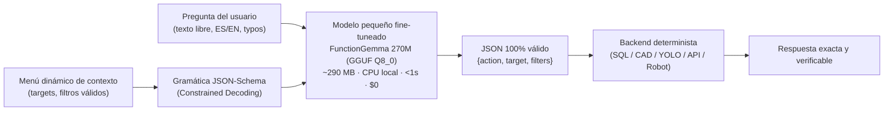

# 🚀 Finetune Kit (Small Models + GGUF + Constrained JSON)

[](https://colab.research.google.com/github/PoliAdrian/finetune-kit/blob/main/notebooks/train_colab.ipynb)

> **Boilerplate reutilizable para hackathones:** entrena un modelo diminuto (270M–4B como **FunctionGemma 270M** o **Gemma 1B**) en **10–15 minutos**, expórtalo a **GGUF** y córrelo **100% en local en CPU** con **gramática JSON estricta** (*constrained decoding*), latencia `< 1s` y coste **\$0 de API**.

Inspirado en la arquitectura ganadora de **Best Use of Gemma** en Junction 2026 ([Blueline / `NiceK1/stoa-spike`](https://github.com/NiceK1/stoa-spike)).

---

## 🧠 ¿Por qué funciona tan bien este patrón en hackathones?

En lugar de hacer otro *wrapper* lento y caro de una API en la nube, divides tu app en **dos fases**:



1. **Modelo especialista diminuto (270M–1B):** solo hace *una* cosa — convertir lenguaje natural en una llamada JSON estructurada.
2. **Constrained Decoding por petición:** generamos un JSON Schema dinámico con los valores válidos de ese documento/sesión. El modelo **matemáticamente no puede** devolver JSON roto ni inventarse campos.
3. **Ejecución determinista:** tu código (SQL, geometría, YOLO, APIs) hace el trabajo pesado sin alucinaciones.
4. **Tabla de benchmark real:** enseñas a los jueces la comparación `Modelo base (0%)` vs `Tu modelo fine-tuneado local (90%+, $0)` vs `API cloud (93%, caro)`.

---

## 💸 ¿Cuánto cómputo y dinero cuesta?

| Modelo base | Método | VRAM | Tiempo (2k–5k ejemplos) | Coste estimado |
| :--- | :--- | :--- | :--- | :--- |
| **FunctionGemma 270M** (`unsloth/functiongemma-270m-it`) | `full` | ~4–6 GB | **5–15 min** | **\$0** (Colab T4 gratis) o **< \$0.50** |
| **Gemma 3 1B / Qwen 0.5B–1.5B** | `lora` (4-bit) | ~6–10 GB | **10–25 min** | **\$0** (Colab T4 gratis) o **< \$1.00** |
| **Gemma 4B / Qwen 3B** | `lora` (4-bit) | ~10–14 GB | **20–40 min** | **\$0** (Colab T4) o **\$0.50–\$1.50** |
| **7B–9B** | `lora` (4-bit) | ~16–24 GB | **30–90 min** | **\$1–\$3** (RunPod / Verda / Modal) |

> **Regla de oro:** en un hackathon, un modelo de **270M–1B** bien fine-tuneado en una tarea estrecha suele ganar a uno de 8B por velocidad de iteración, tamaño (< 300 MB en GGUF) y capacidad de correr en vivo en tu portátil sin internet ni GPU.

---

## ✅ ¿Cuándo usar fine-tuning (y cuándo NO)?

* **SÍ úsalo para:** *function calling* / *routing* a JSON, clasificación o extracción en un dominio concreto, destilación de un LLM caro a uno local/offline, latencia ultrabaja, privacidad (*on-device*).
* **NO lo uses para:** meter conocimiento factual nuevo (usa **RAG**) o chat abierto de propósito general.

---

## 📁 Estructura del repositorio

```text
finetune-kit/
├── schema/
│   └── task_schema.json          # Esquema JSON objetivo (cámbialo para tu hackathon)
├── scripts/
│   ├── 01_generate_dataset.py    # Genera dataset sintético (determinista + parafraseo LLM opcional)
│   ├── 02_train_unsloth.py       # Entrena con Unsloth (full o LoRA) y exporta a GGUF + HF Hub
│   ├── 03_evaluate.py            # Benchmark sobre test.jsonl → tabla Markdown lista para slides
│   └── 04_serve_local.py         # Servidor FastAPI en CPU con llama-cpp-python + JSON grammar
├── notebooks/
│   └── train_colab.ipynb         # Notebook listo para Google Colab (GPU T4 gratis)
├── examples/
│   └── sample_requests.http      # Peticiones de prueba para el servidor local
├── requirements.txt              # Dependencias locales (datos, eval, FastAPI, llama-cpp-python)
└── requirements-train.txt        # Dependencias GPU (Unsloth, TRL, datasets, transformers)
```

---

## ⚡ Quickstart paso a paso

### Paso 0: Instalación local (CPU)

```bash
python -m venv .venv
source .venv/bin/activate   # En Windows: .venv\Scripts\activate
pip install -r requirements.txt
```

*(Si aún no quieres compilar `llama-cpp-python`, puedes instalar primero `pydantic jsonschema fastapi uvicorn httpx` y dejar `llama-cpp-python` para el paso 3.)*

---

### Paso 1: Generar el dataset sintético

El 80% del resultado está en tener ejemplos limpios y variados (distintos idiomas, tono coloquial, faltas de ortografía y ejemplos `unsupported` para evitar alucinaciones).

```bash
python scripts/01_generate_dataset.py --num-samples 2500 --out-dir data
```

Esto crea `data/train.jsonl` (80%), `data/val.jsonl` (10%) y `data/test.jsonl` (10%), validando cada JSON contra `schema/task_schema.json`.

**Bonus (parafraseo con LLM grande):** para darle mucha más naturalidad a las frases, puedes pasar cualquier API compatible con OpenAI (Gemini OpenAI endpoint, OpenRouter, Groq, Ollama):

```bash
LLM_API_URL="https://generativelanguage.googleapis.com/v1beta/openai" \
LLM_API_KEY="tu_api_key" \
LLM_MODEL="gemini-2.5-flash" \
python scripts/01_generate_dataset.py --num-samples 2500 --paraphrase-count 500
```

---

### Paso 2: Entrenar y exportar a GGUF (GPU)

#### Opción A: Gratis en Google Colab (GPU T4)
Abre [`notebooks/train_colab.ipynb`](notebooks/train_colab.ipynb) en Colab, selecciona **T4 GPU** y ejecuta todas las celdas.

#### Opción B: GPU cloud (RunPod / Verda / Modal / Lambda) o GPU local CUDA
```bash
pip install --no-deps unsloth
pip install -r requirements-train.txt

# Full fine-tune para FunctionGemma 270M (~292 MB en Q8_0):
python scripts/02_train_unsloth.py \
    --model unsloth/functiongemma-270m-it \
    --mode full \
    --epochs 3 \
    --quantization q8_0
```

Para subir el `.gguf` directamente a tu perfil de Hugging Face (queda brutal en la entrega del hackathon):

```bash
export HF_TOKEN="hf_..."
python scripts/02_train_unsloth.py \
    --model unsloth/functiongemma-270m-it \
    --mode full \
    --epochs 3 \
    --quantization q8_0 \
    --push-to-hub PoliAdrian/mi-modelo-finetune
```

---

### Paso 3: Evaluar y sacar la tabla de benchmark para el pitch

Compara el **modelo base sin entrenar** contra **tu modelo fine-tuneado** sobre el mismo `data/test.jsonl`:

```bash
python scripts/03_evaluate.py \
    --gguf models/gguf/unsloth.Q8_0.gguf \
    --label "Fine-tuned FunctionGemma 270M (CPU)" \
    --test-file data/test.jsonl \
    --limit 200
```

Te imprimirá una tabla Markdown lista para copiar a tus slides:

```markdown
| Model | Samples | Valid JSON | Exact Match | Action Acc | Target Acc | Avg Latency | P95 Latency | API Cost |
| :--- | ---: | ---: | ---: | ---: | ---: | ---: | ---: | ---: |
| Base FunctionGemma 270M (untuned) | 200 | 100.0% | **4.5%** (9/200) | 18.0% | 12.5% | 420 ms | 510 ms | $0.00 |
| Fine-tuned FunctionGemma 270M (CPU) | 200 | 100.0% | **92.5%** (185/200) | 96.5% | 95.0% | 410 ms | 490 ms | $0.00 |
```

---

### Paso 4: Servir el modelo en local (CPU, \$0, sin internet)

```bash
MODEL_PATH=models/gguf/unsloth.Q8_0.gguf \
uvicorn scripts.04_serve_local:app --reload --port 8000
```

Prueba con `curl`:

```bash
curl -X POST http://127.0.0.1:8000/route \
  -H "Content-Type: application/json" \
  -d '{
    "query": "¿Cuántas ventanas hay en la planta 1 en el piso A?",
    "targets": ["window", "door", "toilet", "balcony"],
    "floors": ["ground", "floor_1", "floor_2"],
    "zones": ["apt_A", "apt_B", "lobby"]
  }'
```

#### ¿Usas Node.js / TypeScript en vez de Python?
Usa [`node-llama-cpp`](https://node-llama-cpp.withcat.ai/) (exactamente como Blueline) con el mismo archivo `.gguf`:

```ts
import { getLlama, LlamaChatSession } from "node-llama-cpp";

const llama = await getLlama();
const model = await llama.loadModel({ modelPath: "models/gguf/unsloth.Q8_0.gguf" });
const context = await model.createContext({ threads: 8 });
const grammar = await llama.createGrammarForJsonSchema(dynamicJsonSchema);

const session = new LlamaChatSession({ contextSequence: context.getSequence() });
const rawJson = await session.prompt(userQuery, { grammar, temperature: 0 });
```

---

## 🛠️ Cómo adaptar este kit a cualquier hackathon en 15 minutos

1. **Edita `schema/task_schema.json`** con las acciones (`enum`) y parámetros que necesite tu app.
2. **Edita los diccionarios y plantillas** (`ALL_TARGETS`, `ALL_FLOORS`, `TEMPLATES`, `UNSUPPORTED_QUERIES`) en `scripts/01_generate_dataset.py`.
3. **Genera 2.000–5.000 ejemplos** y (si tienes API key) parafrasea 500–1.000 con un LLM grande.
4. **Lanza `train_colab.ipynb`** (10–15 min mientras el resto del equipo avanza con el frontend).
5. **Conecta tu lógica real** dentro de `execute_deterministic_action()` en `scripts/04_serve_local.py`.
6. **Corre `03_evaluate.py`** y mete la tabla comparativa + el link de Hugging Face en tu pitch.

---

## 🏆 Checklist para impresionar a los jueces

- [ ] **Modelo subido a Hugging Face** con Model Card explicando dataset, hiperparámetros y métricas.
- [ ] **Demo corriendo en local** (menciona en directo que el portátil podría estar en modo avión y seguiría funcionando a \$0).
- [ ] **Tabla antes vs. después** (modelo base vs. tu fine-tune vs. modelo frontier en nube).
- [ ] **Explicación clara del porqué:** *"No usamos un LLM gigante para todo; destilamos la decisión a 270M con constrained decoding y dejamos la ejecución a código determinista"*.
